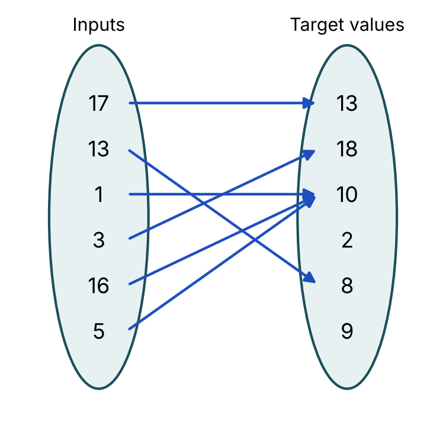
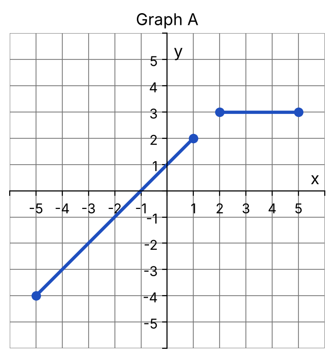
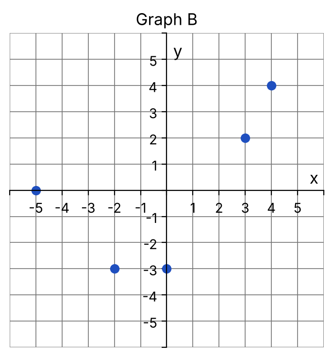
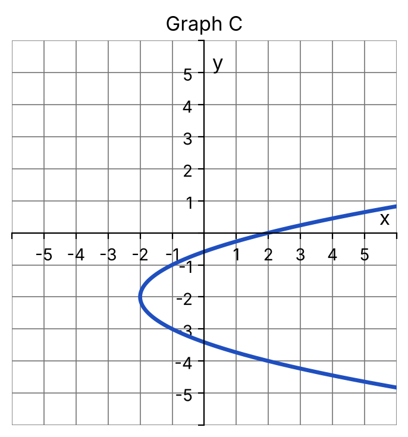
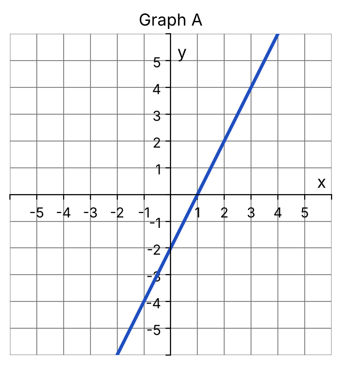
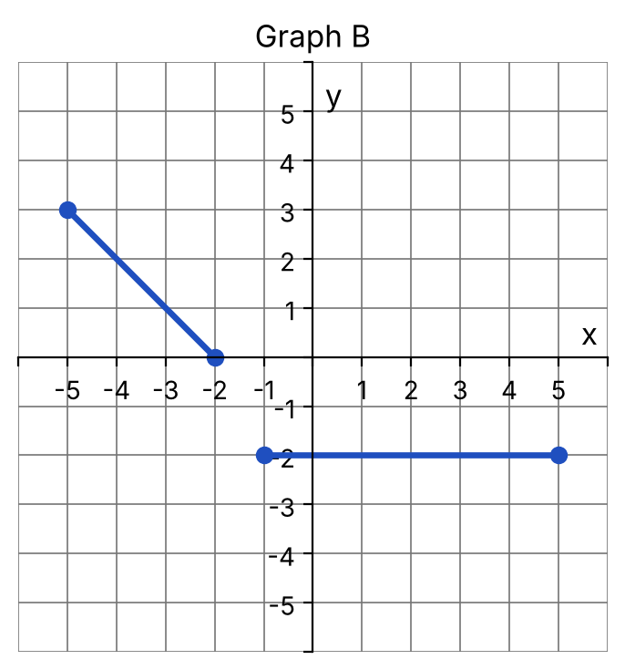
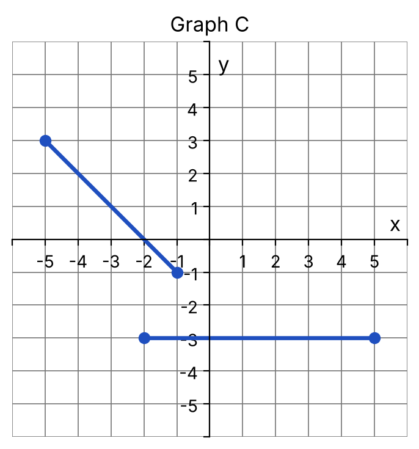
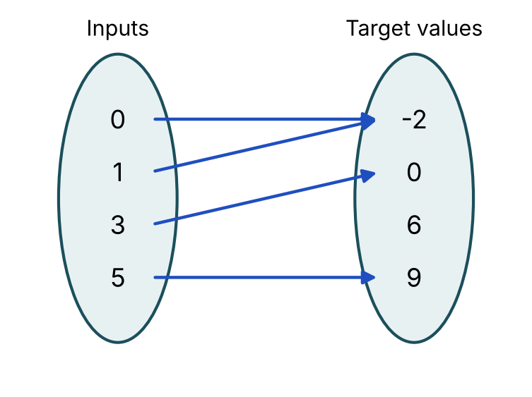

# FN1 · Introduction to Functions (Section 1.1)

**Objective:** Determine if a relation, equation, or graph defines a function using the definition as well as the vertical line test.

Solve every problem. Graphs are in `figures/`, named by problem number.

---

## Problem 1

Explain why each of the following relations does or does not define a function.

**Mapping for part (a)**

*Alt text (what a screen-reader student hears):* Mapping diagram with inputs in a left oval and target values in a right oval. Inputs, top to bottom: 17, 13, 1, 3, 16, 5. Target values, top to bottom: 13, 18, 10, 2, 8, 9. Arrows: 17 to 13; 13 to 8; 1 to 10; 3 to 18; 16 to 10; 5 to 10.

a. The mapping shown above.

b. This table:

*Table for part (b)*

| $x$ | $y$ |
|---|---|
| 18 | 20 |
| 3 | 3 |
| 1 | 11 |
| 18 | 10 |
| 9 | 20 |
| 20 | 20 |

c. These ordered pairs: $\{(17, 15), (7, 15), (14, 15), (18, 10), (10, 14), (19, 8)\}$

---

## Problem 2

Explain why each of the following equations does or does not define $y$ as a function of $x$.

a. $x^{5} = 8 y^{2}$

b. $y^{5} = 8 x^{2}$

---

## Problem 3

Explain why each of the following graphs does or does not represent a function.

**Graph A**

*Alt text (what a screen-reader student hears):* Two pieces, each with closed dots at both ends. A line segment runs from (-5, -4) to (1, 2). A horizontal segment at height 3 runs from (2, 3) to (5, 3). The window shows x and y from -6 to 6 with grid lines 1 unit apart.

*Selected points on Graph A (collapsed toggle on the page):*

| $x$ | $y$ |
|---|---|
| -5 | -4 |
| -4 | -3 |
| -3 | -2 |
| -2 | -1 |
| -1 | 0 |
| 0 | 1 |
| 1 | 2 |
| 2 | 3 |
| 3 | 3 |
| 4 | 3 |
| 5 | 3 |

**Graph B**

*Alt text (what a screen-reader student hears):* Separate points at (-5, 0), (-2, -3), (0, -3), (3, 2), (4, 4). The window shows x and y from -6 to 6 with grid lines 1 unit apart.

*All plotted points on Graph B (collapsed toggle on the page):*

| $x$ | $y$ |
|---|---|
| -5 | 0 |
| -2 | -3 |
| 0 | -3 |
| 3 | 2 |
| 4 | 4 |

**Graph C**

*Alt text (what a screen-reader student hears):* A parabola opening to the right with vertex (-2, -2); both branches continue past the edge of the window. The window shows x and y from -6 to 6 with grid lines 1 unit apart.

*Selected points on Graph C (collapsed toggle on the page):*

| $x$ | $y$ |
|---|---|
| 2 | 0 |
| -1 | -1 |
| -2 | -2 |
| -1 | -3 |
| 2 | -4 |

a. Graph A

b. Graph B

c. Graph C

---

## Problem 4

Explain why each of the following graphs does or does not represent a function.

**Graph A**

*Alt text (what a screen-reader student hears):* A straight line through (0, -2) and (1, 0) that continues past the edges of the window. The window shows x and y from -6 to 6 with grid lines 1 unit apart.

*Selected points on Graph A (collapsed toggle on the page):*

| $x$ | $y$ |
|---|---|
| -1 | -4 |
| 0 | -2 |
| 1 | 0 |
| 2 | 2 |
| 3 | 4 |

**Graph B**

*Alt text (what a screen-reader student hears):* Two pieces, each with closed dots at both ends. A line segment runs from (-5, 3) to (-2, 0). A horizontal segment at height -2 runs from (-1, -2) to (5, -2). The window shows x and y from -6 to 6 with grid lines 1 unit apart.

*Selected points on Graph B (collapsed toggle on the page):*

| $x$ | $y$ |
|---|---|
| -5 | 3 |
| -4 | 2 |
| -3 | 1 |
| -2 | 0 |
| -1 | -2 |
| 0 | -2 |
| 1 | -2 |
| 2 | -2 |
| 3 | -2 |
| 4 | -2 |
| 5 | -2 |

**Graph C**

*Alt text (what a screen-reader student hears):* Two pieces, each with closed dots at both ends. A line segment runs from (-5, 3) to (-1, -1). A horizontal segment at height -3 runs from (-2, -3) to (5, -3). The window shows x and y from -6 to 6 with grid lines 1 unit apart.

*Selected points on Graph C (collapsed toggle on the page):*

| $x$ | $y$ |
|---|---|
| -5 | 3 |
| -4 | 2 |
| -3 | 1 |
| -2 | 0 |
| -1 | -1 |
| -2 | -3 |
| -1 | -3 |
| 0 | -3 |
| 1 | -3 |
| 2 | -3 |
| 3 | -3 |
| 4 | -3 |
| 5 | -3 |

a. Graph A

b. Graph B

c. Graph C

---

## Problem 5

Consider the two relations below.

a. Does $A = \{(3, 9), (-4, 2), (2, 4), (1, 9), (-1, 5)\}$ define a function? Explain.

b. Does $B = \{(2, 2), (9, -2), (-2, 6), (-3, 3), (-2, 9)\}$ define a function? Explain.

c. Remove exactly one ordered pair from $B$ so that it defines a function. Which pair(s) could you remove?

---

## Problem 6

Use the mapping below.

**Mapping**

*Alt text (what a screen-reader student hears):* Mapping diagram with inputs in a left oval and target values in a right oval. Inputs, top to bottom: 0, 1, 3, 5. Target values, top to bottom: -2, 0, 6, 9. Arrows: 0 to -2; 1 to -2; 3 to 0; 5 to 9.

a. Does this mapping define a function? Explain.

b. List the domain.

c. List the range.

---

## Problem 7

Let $f(x) = \sqrt{3 x - 6}$ and $g(x) = \sqrt{9 - 2 x}$.

a. Find the domain of $f$. Write it in interval notation.

b. Find the domain of $g$. Write it in interval notation.

c. Is $f(1)$ a real number? Explain using part (a).

---

## Problem 8

Let $f(x) = \frac{\sqrt{x + 1}}{x - 1}$.

a. Which inputs make the radicand negative?

b. Which input makes the denominator zero?

c. Write the domain of $f$ in interval notation.

---

## Problem 9

A student was asked: *Does $\{(4, 7), (-1, 6), (6, 7), (0, 8)\}$ define a function? Explain.*

> *A student's work:*
> "The output $7$ shows up twice, at $(4, 7)$ and $(6, 7)$. So this relation is **not** a function."
>

a. Find the slip in the student's reasoning and explain it in a sentence.

b. Give the correct answer with a reason.

---

## Problem 10

The graph of $x^2 + y^2 = 25$ is a circle of radius $5$ centered at the origin.

a. Show that $x^2 + y^2 = 25$ does not define $y$ as a function of $x$ by finding one input with two outputs.

b. Solve for $y$. You should get two functions. Which one gives the top half of the circle?

c. What is the domain of the top-half function?
