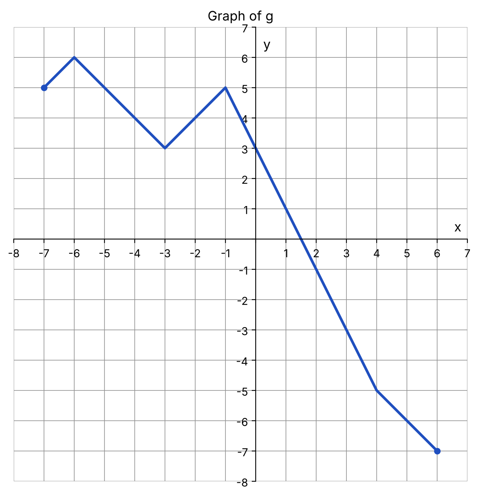
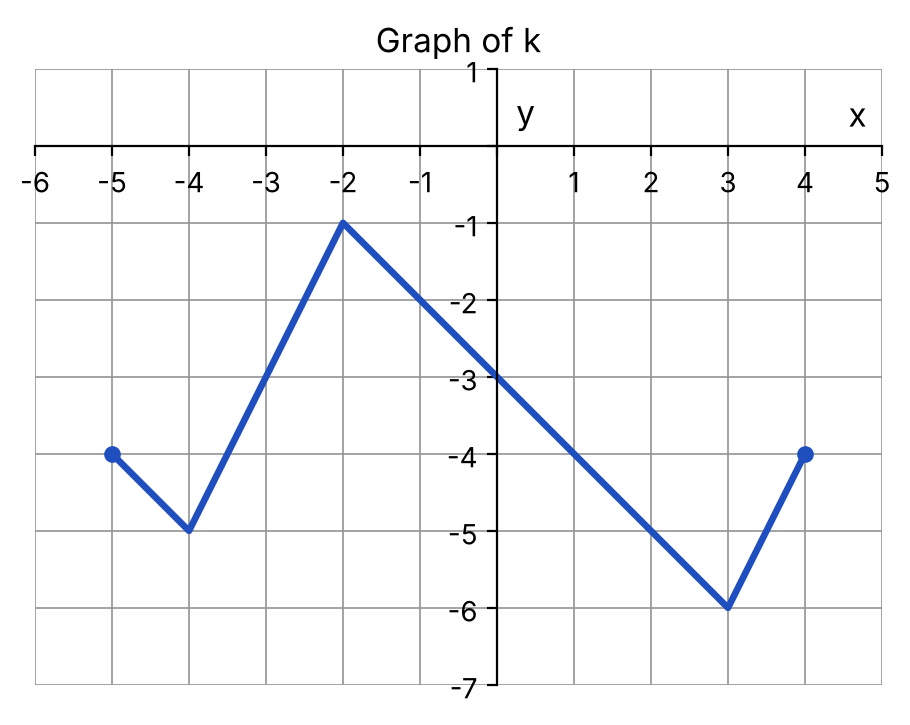
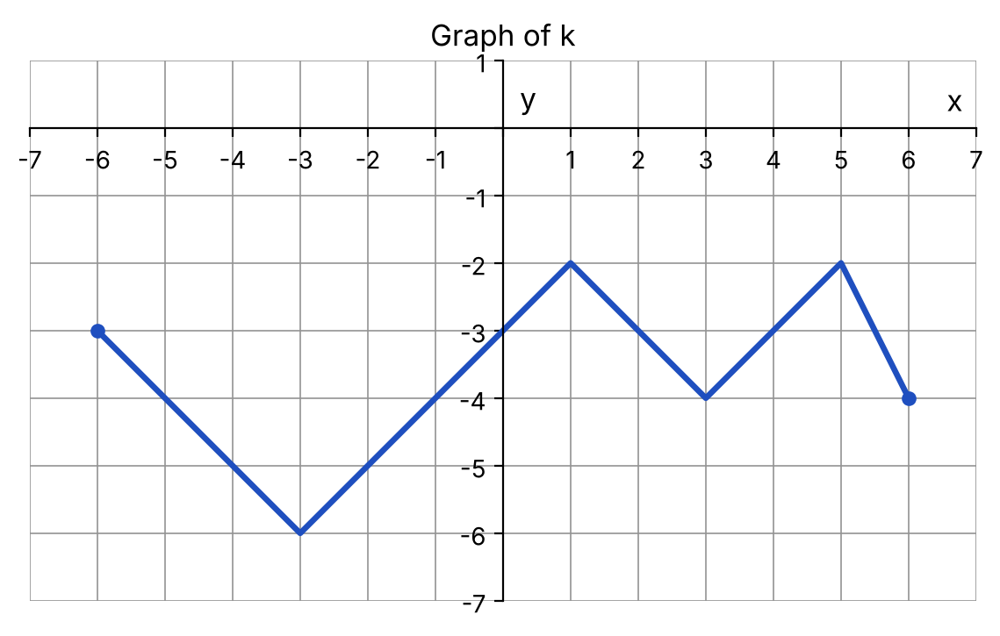

# FN2 · Function Notation (Section 1.2)

**Objective:** Use and interpret function notation to evaluate a function for a given input value and find a corresponding input value given an output value.

Solve every problem. Graphs are in `figures/`, named by problem number.

---

## Problem 1

Let $k(x) = \begin{cases} \sqrt{x^{2} + 1} & -5 < x < 2 \\ \frac{4 x - 2}{x^{2} + 4} & 2 \le x < 5 \end{cases}$.

a. Find $k(3)$.

b. Find $k(-3)$.

c. Find $k(2)$.

---

## Problem 2

Let $g(x)$ be the function graphed below.

*Alt text (what a screen-reader student hears):* Graph of g: connected line segments joining the points (-7, 5), (-6, 6), (-3, 3), (-1, 5), (4, -5), (6, -7), with closed dots at both ends. The domain is [-7, 6]. Grid lines are 1 unit apart; the x-axis is shown from -8 to 7 and the y-axis from -8 to 7. A table of values for this graph is available below it.

*Table of values (collapsed toggle on the page):*

| $x$ | $g(x)$ |
|---|---|
| -7 | 5 |
| -6.5 | 5.5 |
| -6 | 6 |
| -5.5 | 5.5 |
| -5 | 5 |
| -4.5 | 4.5 |
| -4 | 4 |
| -3.5 | 3.5 |
| -3 | 3 |
| -2.5 | 3.5 |
| -2 | 4 |
| -1.5 | 4.5 |
| -1 | 5 |
| -0.5 | 4 |
| 0 | 3 |
| 0.5 | 2 |
| 1 | 1 |
| 1.5 | 0 |
| 2 | -1 |
| 2.5 | -2 |
| 3 | -3 |
| 3.5 | -4 |
| 4 | -5 |
| 4.5 | -5.5 |
| 5 | -6 |
| 5.5 | -6.5 |
| 6 | -7 |

a. Find $g(-5)$.

b. For which $x$-value(s) in the interval $[-7, 6]$ does $g(x) = 0$?

---

## Problem 3

Let $p(x) = \begin{cases} 2 x^{2} + x & -5 < x \le 2 \\ \frac{x - 3}{2 x^{2} + 1} & 2 < x < 5 \end{cases}$.

a. Find $p(2)$.

b. Find $p(3)$.

c. Find $p(-4)$.

---

## Problem 4

Let $k(x)$ be the function graphed below.

*Alt text (what a screen-reader student hears):* Graph of k: connected line segments joining the points (-5, -4), (-4, -5), (-2, -1), (3, -6), (4, -4), with closed dots at both ends. The domain is [-5, 4]. Grid lines are 1 unit apart; the x-axis is shown from -6 to 5 and the y-axis from -7 to 1. A table of values for this graph is available below it.

*Table of values (collapsed toggle on the page):*

| $x$ | $k(x)$ |
|---|---|
| -5 | -4 |
| -4.5 | -4.5 |
| -4 | -5 |
| -3.5 | -4 |
| -3 | -3 |
| -2.5 | -2 |
| -2 | -1 |
| -1.5 | -1.5 |
| -1 | -2 |
| -0.5 | -2.5 |
| 0 | -3 |
| 0.5 | -3.5 |
| 1 | -4 |
| 1.5 | -4.5 |
| 2 | -5 |
| 2.5 | -5.5 |
| 3 | -6 |
| 3.5 | -5 |
| 4 | -4 |

a. Find $k(0)$.

b. For which $x$-value(s) in the interval $[-5, 4]$ does $k(x) = -4$?

---

## Problem 5

Let $p(x) = x^{2} - 7$.

a. Find $p(4)$.

b. Find and simplify $p(a+1)$.

c. Find every input $x$ for which $p(x) = -3$.

---

## Problem 6

Let $g(x) = \begin{cases} \sqrt{x + 6} & -6 \le x < 0 \\ x^{2} - x - 1 & 0 \le x \le 4 \end{cases}$.

a. Find $g(-2)$, or explain why it is undefined.

b. Find $g(0)$, or explain why it is undefined.

c. Find $g(6)$, or explain why it is undefined.

---

## Problem 7

Let $p(x) = \frac{4 x - 1}{x + 1}$.

a. Find $p(0)$.

b. Explain why $p(-1)$ is undefined.

c. Solve $p(x) = 3$.

---

## Problem 8

Let $k(x)$ be the function graphed below.

*Alt text (what a screen-reader student hears):* Graph of k: connected line segments joining the points (-6, -3), (-3, -6), (1, -2), (3, -4), (5, -2), (6, -4), with closed dots at both ends. The domain is [-6, 6]. Grid lines are 1 unit apart; the x-axis is shown from -7 to 7 and the y-axis from -7 to 1. A table of values for this graph is available below it.

*Table of values (collapsed toggle on the page):*

| $x$ | $k(x)$ |
|---|---|
| -6 | -3 |
| -5.5 | -3.5 |
| -5 | -4 |
| -4.5 | -4.5 |
| -4 | -5 |
| -3.5 | -5.5 |
| -3 | -6 |
| -2.5 | -5.5 |
| -2 | -5 |
| -1.5 | -4.5 |
| -1 | -4 |
| -0.5 | -3.5 |
| 0 | -3 |
| 0.5 | -2.5 |
| 1 | -2 |
| 1.5 | -2.5 |
| 2 | -3 |
| 2.5 | -3.5 |
| 3 | -4 |
| 3.5 | -3.5 |
| 4 | -3 |
| 4.5 | -2.5 |
| 5 | -2 |
| 5.5 | -3 |
| 6 | -4 |

a. Find $k(-2)$.

b. For which $x$-value(s) in the interval $[-6, 6]$ does $k(x) = -4$?

---

## Problem 9

A student was asked: *Let $f(x) = x^{2} - 3$. Find every input $x$ for which $f(x) = 6$.*

> *A student's work:*
> $x^{2} - 3 = 6$  
> $x^2 = 9$  
> $x = 3$  
> "So the only input is $x = 3$."
>

a. Find the slip in the student's work and explain it in a sentence.

b. Give the correct answer and check it.

---

## Problem 10

Let $g(x) = x^{2} + 2 x$.

a. Find and simplify $\frac{g(3+h) - g(3)}{h}$ for $h \ne 0$.

b. Evaluate your answer for $h = 0.1$, $h = 0.01$, and $h = 0.001$. What number do the values approach as $h$ gets closer to $0$?

c. The expression in part (a) is the slope of the *secant line* through two points on the graph of $g$. Which two points?
